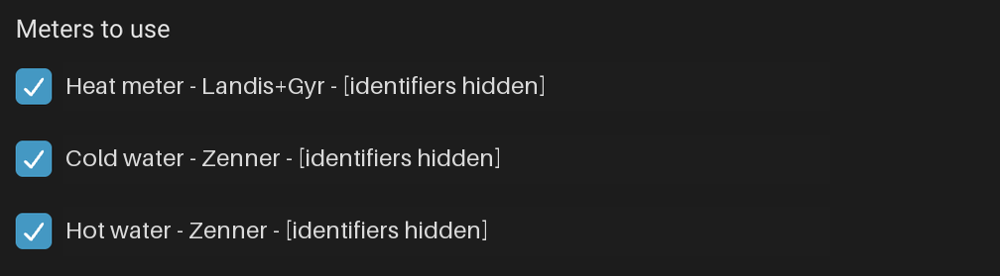
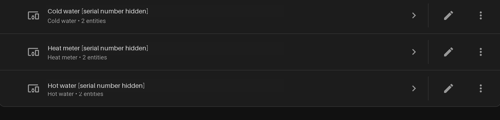

# Odecty vodomeru for Home Assistant

An unofficial Home Assistant custom integration for
[odectyvodomeru.cz](https://odectyvodomeru.cz). View your water and heat meter
readings in Home Assistant using the same account you use on the portal.

Developed for **Home Assistant 2026.10.4**. This is a custom integration, **not an
add-on**. HACS metadata is included for installation as a custom repository.

## Features

- Sign in through the Home Assistant UI and choose which meters to include.
- Support for active cold-water, hot-water, and heat meters.
- One Home Assistant device per selected meter, with manufacturer, type, and
  serial number.
- Shared hourly polling, automatic re-login when the access token expires, and
  reauthentication when credentials need updating.
- Change your meter selection through **Configure**, without recreating the
  integration.
- English and Czech setup text and entity names.

Each selected device provides three entities:

| Entity | Information |
| --- | --- |
| **Meter reading** | Cumulative water volume in m³ or heat energy in MWh |
| **Last reading** | The source timestamp of the latest reading |
| **Meter information** | Serial number, with address, flat/floor numbers, names, portal IDs, and RSSI as attributes when available |

To see location details, open **Meter information**, select **⋮ > Details**, and
look under **Attributes**. The initial dialog displays the serial number, not
the attribute list.

## Screenshots

### Meter selection

Choose the cold-water, hot-water, and heat meters you want to include.



### Registered devices

Your selected meters appear as individual Home Assistant devices.



These screenshots were cropped from development builds and real meter
identifiers were anonymized. The device screenshot shows an earlier release;
the current version adds **Meter information**, for three entities per device.

## Installation

### HACS

Use the public GitHub repository as a HACS custom repository:

1. Open HACS and choose **⋮ > Custom repositories**.
2. Enter `https://github.com/f0x052/ha-odectyvodomeru` and select **Integration**.
3. Add the repository, find **Odecty vodomeru**, and download it.
4. Restart Home Assistant, then complete the setup described below.

### Manual

1. Make a Home Assistant backup.
2. Download or clone this repository.
3. Find your Home Assistant configuration directory: the folder containing
   `configuration.yaml`. On Home Assistant OS it is usually `/config`; with
   Container, use the host folder mounted at `/config`.
4. Copy the entire `custom_components/odectyvodomeru` folder from this repository
   into `<configuration directory>/custom_components/`. Create
   `custom_components` if necessary. Keep all files, including `brand/` and
   `translations/`:

   ```text
   <configuration directory>/
     configuration.yaml
     custom_components/
       odectyvodomeru/
         __init__.py
         api.py
         brand/
         config_flow.py
         const.py
         coordinator.py
         manifest.json
         sensor.py
         strings.json
         translations/
   ```

5. Restart Home Assistant. Reloading YAML is not sufficient.
6. Open **Settings > Devices & services > Add integration**, search for
   **Odecty vodomeru** (or **Odečty vodoměrů** in Czech), and sign in with your
   portal username/email and password.
7. Select at least one meter and finish setup. Nothing is selected automatically.

No changes to `configuration.yaml` are required. If the integration does not
appear, refresh your browser and check **Settings > System > Logs** for
`odectyvodomeru`.

## Using and updating the integration

Find your selected meters under **Settings > Devices & services > Odecty
vodomeru**. The service entry includes your login email unless you give it a
custom name. Use **Configure** to change the selection; deselected devices and
their entities are removed. Removing and later reselecting a device does not
restore its previous customizations.

Readings refresh hourly, but the portal may publish new measurements only once
a day. For a manual refresh, use **Developer tools > Actions >
Home Assistant: Update entity** (`homeassistant.update_entity`) on a reading
entity. Missing or invalid readings become unavailable instead of reporting zero.

To update, back up Home Assistant, replace the installed
`custom_components/odectyvodomeru` folder with the updated copy, and restart Home
Assistant. **Do not remove the integration first**; your account, meter
selection, and existing entity identities are retained.

For an installation managed through HACS, download the
update through HACS instead of copying files manually, then restart Home Assistant.

## Consumption graphs

Cumulative readings support Home Assistant's long-term statistics for daily,
monthly, and yearly consumption graphs. Keep Recorder enabled and do not exclude
these reading entities.

For example, add a **Manual** dashboard card and replace the entity ID below
with your meter's **Meter reading** entity:

```yaml
type: statistics-graph
title: Daily water consumption
chart_type: bar
period: day
days_to_show: 30
stat_types: [change]
entities:
  - sensor.replace_with_your_water_meter_reading
```

For monthly or yearly graphs, use `period: month` or `period: year` with a longer
`days_to_show` range. Keep water and heat on separate graphs because their units
differ.

Historical backfill is not implemented. The first observed reading establishes
a baseline; usage appears after subsequent changes. Statistics use the time
Home Assistant observes a reading, so delayed portal updates or outages can shift
consumption into a later day. These graphs are not exact billing-calendar reports.

## Privacy and limitations

Home Assistant stores your username and password in its config-entry storage;
this integration does not encrypt them. Protect your configuration directory and
backups. Access tokens stay in memory, and credentials and raw API responses are
not logged.

Location attributes can contain personal information and may be stored by
Recorder and backups. Redact them, credentials, and account details before
sharing screenshots or logs.

Internet access to `api.goliash.cz` is required. The portal API is undocumented
and may change. Instantaneous flow/power and historical imports are not provided.

## License

The integration code is available under the [MIT license](LICENSE). The bundled
Renova brand artwork belongs to its respective owner, is not covered by that
license, and is used only to identify the service. This project is unofficial.
