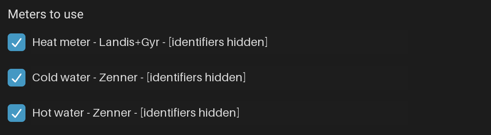
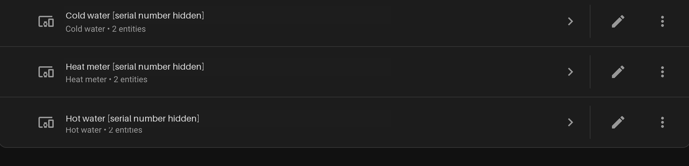

# Odecty vodomeru for Home Assistant

An unofficial custom integration for [odectyvodomeru.cz](https://odectyvodomeru.cz),
developed for **Home Assistant 2026.10.4**. Sign in with your portal account and
choose which water and heat meters to display.

## What you get

- Cold-water and hot-water cumulative readings in **m³**.
- Heat-meter cumulative readings in **MWh**.
- One device per selected meter, with manufacturer, type, and serial number.
- Three entities per device: **Meter reading**, **Last reading**, and
  **Meter information**.
- Shared hourly polling, automatic re-login on token expiry, and reauthentication
  when credentials need updating.
- Daily, monthly, and yearly consumption graphs through Home Assistant's
  long-term statistics.
- English and Czech setup text and entity names.

**Meter information** includes the address, flat/floor numbers, names, portal IDs,
and RSSI when available. Open the entity and choose **⋮ > Details > Attributes**;
the first screen shows only the serial number.

## Screenshots

### Choose the meters you want to use

### See your selected meters as Home Assistant devices

These are cropped screenshots from development builds, with real meter
identifiers anonymized. The device screenshot predates **Meter information**;
the current version creates three entities per device, not the two shown.

## Installation

### HACS

Add the public GitHub repository as a HACS custom repository:

1. In HACS, open **⋮ > Custom repositories**.
2. Enter `https://github.com/f0x052/ha-odectyvodomeru` and select **Integration**
   as the category.
3. Add it, find **Odecty vodomeru**, download it, and restart Home Assistant.

### Manual

1. Back up Home Assistant.
2. Copy the complete `custom_components/odectyvodomeru` folder into your Home
   Assistant configuration directory's `custom_components/` folder.
3. Restart Home Assistant.

See the [README](README.md) for the complete folder layout, upgrade instructions,
and a consumption-graph example.

## Setup

1. Open **Settings > Devices & services > Add integration**.
2. Search for **Odecty vodomeru** (or **Odečty vodoměrů** in Czech).
3. Enter your portal username/email and password.
4. Choose at least one meter and finish setup.

No YAML configuration is needed. Use **Configure** on the integration to change
your selection later. Keep the existing integration when upgrading to preserve
its account, selection, and entity identities.

## Before you start

- Internet access to `api.goliash.cz` and a working portal account are required.
- Source readings may change only daily even though polling is hourly.
- Keep Recorder enabled for the cumulative reading entities. Statistics start
  from the first observed reading; historical backfill is not implemented.
- Statistics use Home Assistant observation time, so delayed readings and outages
  can shift consumption into a later day.
- Credentials are stored in Home Assistant's config-entry storage, not encrypted
  by this integration. Protect your configuration and backups, and redact account
  and location data before sharing screenshots.

This is a custom integration, not an add-on. The API is undocumented and may
change. The code is [MIT licensed](LICENSE); the bundled Renova artwork belongs
to its respective owner and is not included in that license.
